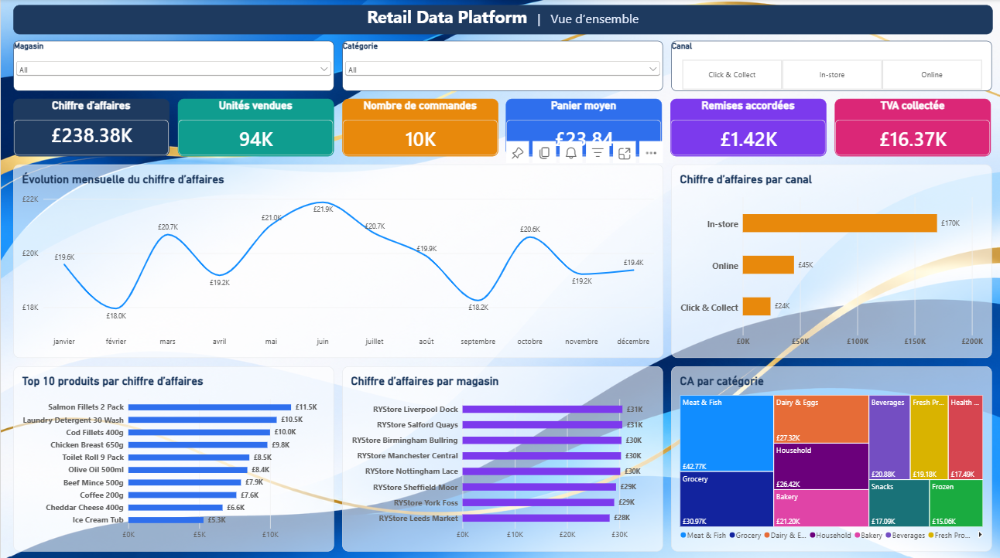
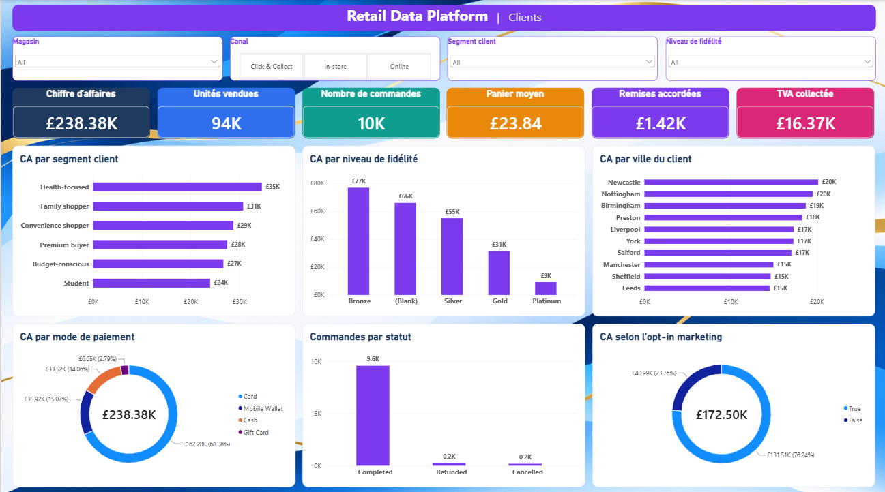
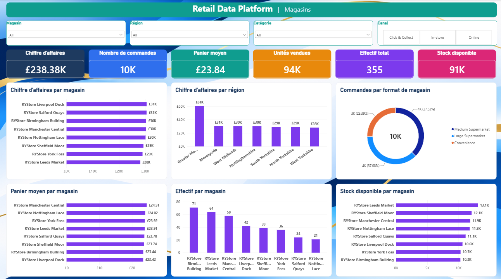
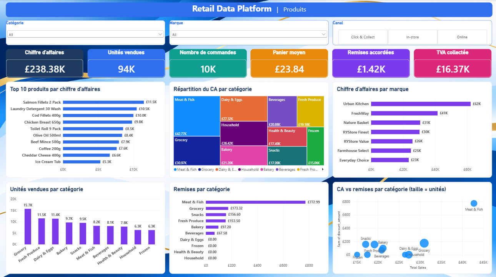
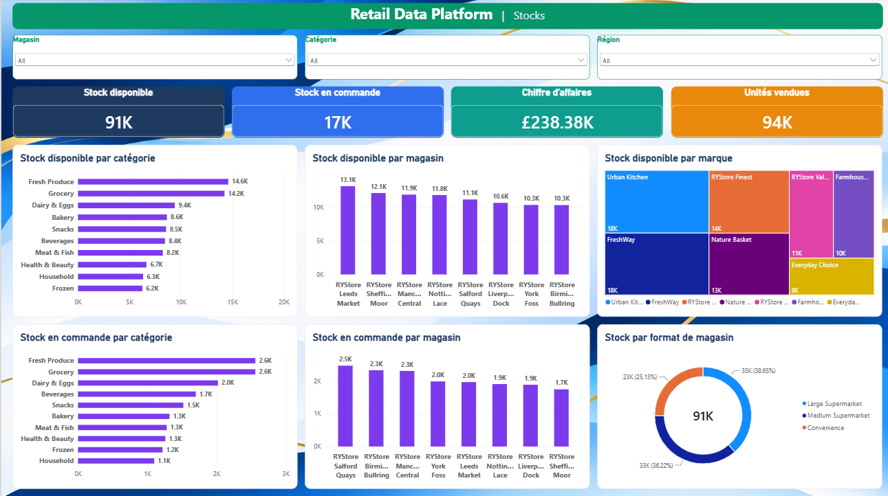
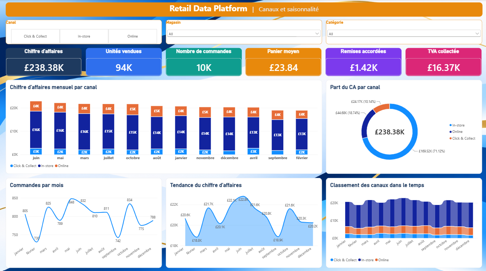
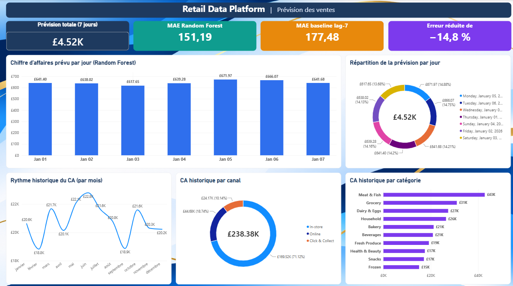
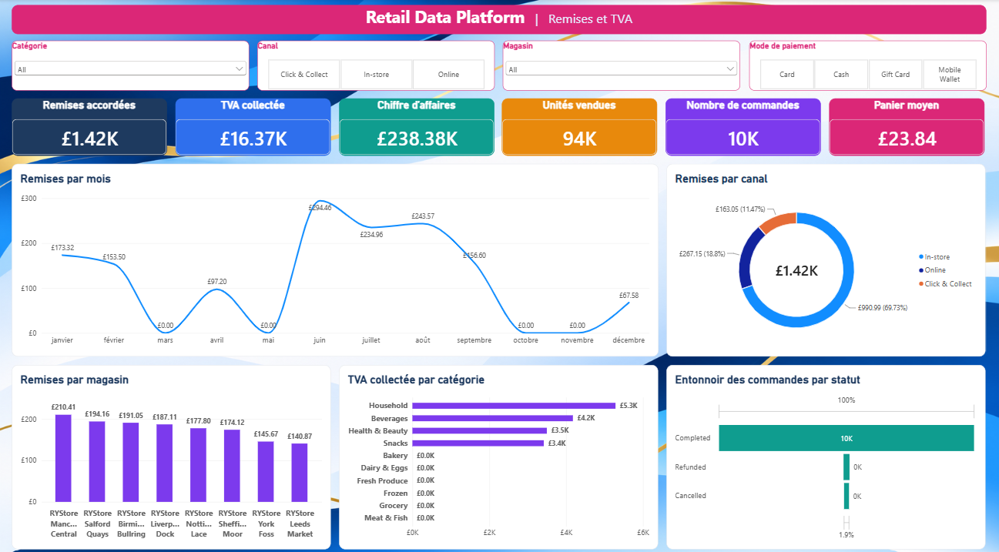

# Retail Data Platform 2026 | Data Engineering, BI & AI

An end-to-end retail data platform combining data engineering, analytics, business intelligence, machine learning, and local AI integration.

The project transforms retail operational data into validated analytical datasets, interactive dashboards, sales forecasts, and natural-language business insights.

## Project Overview

**Retail Data Platform 2026** demonstrates a complete data workflow, from raw data ingestion to business intelligence and AI-assisted analytics.

The platform integrates Python, SQL, DuckDB, Apache Airflow, Apache Spark, dbt, Power BI, and Streamlit.

### Key Features

- **Data Engineering:** Python and SQL transformations, automated pipelines, and data processing.
- **Workflow Orchestration:** Apache Airflow DAG for pipeline execution.
- **Distributed Processing:** Apache Spark for data transformation and aggregation.
- **Analytical Database:** DuckDB with fact and dimension tables.
- **Data Transformation:** dbt models and data validation.
- **Data Quality:** Checks for duplicates, missing values, relationships, keys, and analytical consistency.
- **Business Intelligence:** Multi-page Power BI dashboards.
- **Machine Learning:** Seven-day sales forecasting and model evaluation.
- **AI Copilot:** Local LLM integration using Ollama and Llama 3.2.
- **Interactive Analytics:** Streamlit dashboard and AI interface.
- **Automated Testing:** Pytest and GitHub Actions CI workflow.
- **Data Export:** Parquet datasets for downstream analytics.

## Technology Stack

| Area | Technologies |
|---|---|
| Programming | Python, SQL |
| Data Processing | Pandas, Apache Spark |
| Workflow Orchestration | Apache Airflow |
| Analytical Database | DuckDB |
| Data Transformation | dbt |
| Data Storage | Parquet, CSV |
| Business Intelligence | Power BI |
| Interactive Applications | Streamlit |
| Machine Learning | Scikit-learn, Random Forest |
| Local AI | Ollama, Llama 3.2 |
| Containerization | Docker, Docker Compose |
| Testing and Quality | Pytest, Ruff |
| CI/CD | GitHub Actions |
| Version Control | Git, GitHub |

## Architecture

The platform follows an end-to-end data architecture:

1. **Data Sources:** Retail CSV files containing orders, customers, products, stores, inventory, suppliers, and promotions.
2. **Ingestion and Processing:** Python, SQL, and Spark scripts process and transform source data.
3. **Orchestration:** Apache Airflow coordinates pipeline execution.
4. **Analytical Storage:** DuckDB stores the analytical data model.
5. **Transformation and Validation:** SQL and dbt models prepare analytical datasets and validate data consistency.
6. **Data Export:** Analytical tables are exported to Parquet.
7. **Machine Learning:** Forecasting models generate sales predictions and are evaluated against baseline approaches.
8. **Business Intelligence:** Power BI and Streamlit provide interactive reporting.
9. **AI Integration:** A local AI Copilot interprets supported business questions and retrieves results through predefined SQL queries.

## Analytical Data Model

The analytical model includes the following tables:

| Table | Description |
|---|---|
| `fact_sales` | Sales transactions and order-item information |
| `dim_products` | Product information |
| `dim_stores` | Store information |
| `dim_customers` | Customer information |
| `fact_inventory` | Inventory and stock information |
| `daily_sales` | Daily sales aggregated by channel |
| `forecast_sales` | Sales forecast outputs |
| `forecast_model_metrics` | Forecast evaluation metrics |

### Model Validation

The analytical model was validated using automated checks covering:

- Duplicate primary keys.
- Missing essential values.
- Invalid relationships and foreign keys.
- Negative or invalid quantities.
- Source-to-model sales consistency.
- Daily aggregation consistency.
- Forecast output validation.

The analytical model contains 47,512 sales records, 66 products, 8 stores, 800 customers, and 528 inventory records.

## Power BI Dashboards

The Power BI report provides several perspectives on retail business performance.

### Dashboard Screenshots

#### 1. Sales Overview



#### 2. Customer Analysis



#### 3. Store Performance



#### 4. Product Analysis



#### 5. Inventory Analysis



#### 6. Sales Channels and Seasonality



#### 7. Sales Forecasting



#### 8. Discounts and VAT Analysis



Open `Retail_Data_Platform.pbix` with Power BI Desktop to explore the complete report.

After regenerating the Parquet exports, refresh the datasets in Power BI Desktop.

## Sales Forecasting and Machine Learning

The project includes a seven-day sales forecasting component.

Several approaches were evaluated across 26 rolling validation periods.

### Model Evaluation

| Model | MAE |
|---|---:|
| Historical Average | 117.80 |
| Average by Weekday | 119.02 |
| Random Forest | 128.21 |
| Lag-7 Baseline | 167.76 |

The historical average achieved the lowest MAE in the rolling evaluation.

The Random Forest improved upon the lag-7 baseline by approximately 14.8% on the December test month, but did not outperform the historical average across all 26 evaluation periods.

The forecasting pipeline uses the best-performing approach selected by the champion-model logic implemented in `src/forecast_champion.py`.

**Important:** The dataset covers January–December 2025. The January 1–7, 2026 forecast is a historical project output, not a current forecast.

## AI Copilot

The project includes a local AI assistant built with Streamlit, Ollama, and Llama 3.2.

The assistant interprets supported business questions and retrieves information through predefined, read-only SQL queries.

Supported analytical topics include:

- Overall sales performance.
- Sales by channel.
- Top products by revenue.
- Monthly sales trends.
- Sales by product category.
- Seven-day sales forecast.

The language model does not generate executable SQL. Python selects approved queries, and DuckDB is accessed in read-only mode.

## Streamlit Sales Dashboard

A separate interactive dashboard is available in `dashboards/sales_dashboard.py`.

Features include:

- Revenue, order count, average order value, and units sold.
- Daily sales trends.
- Revenue by sales channel.
- Top five products by revenue.
- Sales forecast visualization.
- Date and channel filters.
- CSV export functionality.

## Business Rules and KPIs

Business definitions are documented in `docs/business_rules.md`.

Only orders with the status `Completed` are included in the main sales KPIs. Monetary amounts are expressed in GBP, according to the source data dictionary.

| KPI | Value |
|---|---:|
| Net Sales (excluding VAT) | £228,457.01 |
| Revenue (including VAT and delivery) | £249,520.30 |
| Completed Orders | 9,589 |
| Quantity Sold | 90,585 |
| Average Order Value | £26.02 |

## Key Business Findings

Detailed findings are available in `docs/analysis_findings.md`.

Some highlights:

- Promotions represent approximately 4.9% of net sales.
- Identified and anonymous customers have similar average baskets (£23.84 vs £23.78).
- Convenience stores generate comparable sales to larger supermarkets with approximately three times fewer staff per sale.
- 92 store-product combinations are below their reorder level, including 57 without a pending order.

## Automated Testing and CI

The project uses Pytest for automated testing and GitHub Actions for continuous integration.

The CI workflow includes:

- Python syntax validation.
- Code quality checks with Ruff.
- SQL transformation tests.
- Analytical model integrity tests.
- Forecasting tests.
- SQL file validation.

Run the complete test suite locally:

```powershell
.\.venv\Scripts\python.exe -m pytest tests -v
```

**Latest recorded local test result: 41 tests passed successfully.**

## Prerequisites

- Windows
- Python 3.11
- Git
- Docker Desktop
- Power BI Desktop
- Ollama with the `llama3.2:3b` model (for the AI Copilot)

## Installation and Setup

Clone the repository:

```bash
git clone https://github.com/mariemmannai1/retail-data-platform.git
cd retail-data-platform
```

Create a Python virtual environment:

```powershell
python -m venv .venv
```

Install the main dependencies:

```powershell
.\.venv\Scripts\python.exe -m pip install pandas duckdb scikit-learn streamlit ollama pyarrow pytest ruff
```

Install and start Ollama, then download the model:

```powershell
ollama pull llama3.2:3b
```

## Running the Project

### 1. Run the Main Data Pipeline

```powershell
.\.venv\Scripts\python.exe .\src\run_pipeline.py
```

Run with forecasting:

```powershell
.\.venv\Scripts\python.exe .\src\run_pipeline.py --with-forecast
```

### 2. Run the Streamlit Dashboard

```powershell
.\.venv\Scripts\python.exe -m streamlit run .\dashboards\sales_dashboard.py
```

### 3. Run the AI Copilot

```powershell
.\.venv\Scripts\python.exe -m streamlit run .\src\ai_copilot.py
```

### 4. Run with Docker

Make sure Docker Desktop is installed and running.

Build the Docker images:

```powershell
docker compose build
```

Execute the retail pipeline:

```powershell
docker compose run --rm retail-pipeline
```

The Docker pipeline executes the analytical transformations, data-quality validations, sales consistency checks, forecast loading, and Parquet export validation.

The Docker test pipeline uses a separate database (`retail_docker_test.duckdb`) and export directory (`data/powerbi_docker_test/`) to avoid overwriting the original local outputs.

To rebuild images after changing dependencies or Docker configuration:

```powershell
docker compose build --no-cache
```

## Repository Structure

```text
retail-data-platform/
│
├── airflow/                 # Airflow configuration and DAGs
├── dashboards/              # Streamlit sales dashboard
├── data/
│   ├── raw/                  # Source CSV files (not tracked)
│   ├── powerbi/              # Generated Parquet exports
│   └── processed/            # Processed datasets
│
├── dbt/                      # dbt project (if maintained at root)
├── docs/                     # Business rules and analysis documentation
├── retail_dbt/               # Retail dbt project
├── screenshots/              # Power BI dashboard screenshots
├── sql/                      # SQL transformations and analysis
├── src/                      # Python pipeline, Spark, forecasting, AI
├── tests/                    # Automated tests
│
├── Retail_Data_Platform.pbix
├── compose.yaml
├── .github/workflows/        # GitHub Actions CI
├── .gitignore
└── README.md
```

## Data Availability

Raw CSV files, generated Parquet exports, and local DuckDB databases are excluded from version control.

The source data must be obtained separately and placed in `data/raw/` before executing the pipeline.

Local configuration files, credentials, and generated logs should not be committed to the repository.

## Limitations

- The source dataset represents a retail business scenario and should not be interpreted as live production data.
- Forecast quality depends on historical data, seasonality, and model assumptions.
- The AI Copilot only supports the analytical questions implemented in its approved query set.
- The forecasting results are experimental and should not be treated as guaranteed business predictions.

## Author

Developed as a portfolio project demonstrating practical skills in:

**Data Engineering · Data Analytics · Business Intelligence · Machine Learning · AI Integration**

GitHub Repository: [mariemmannai1/retail-data-platform](https://github.com/mariemmannai1/retail-data-platform)